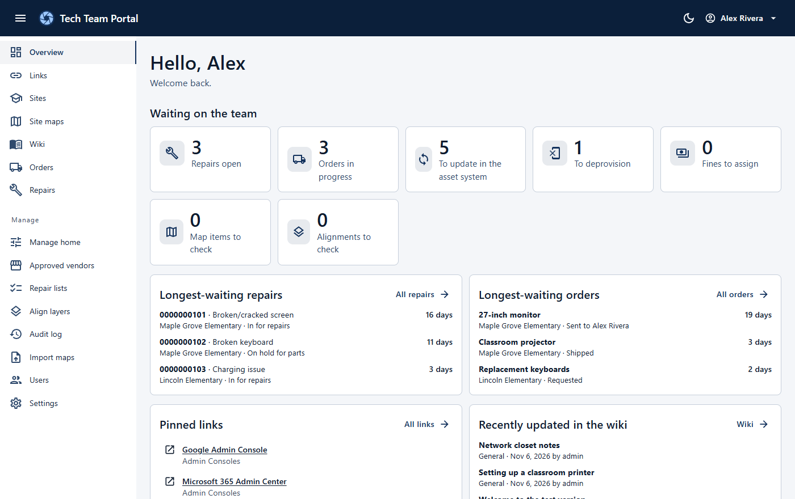
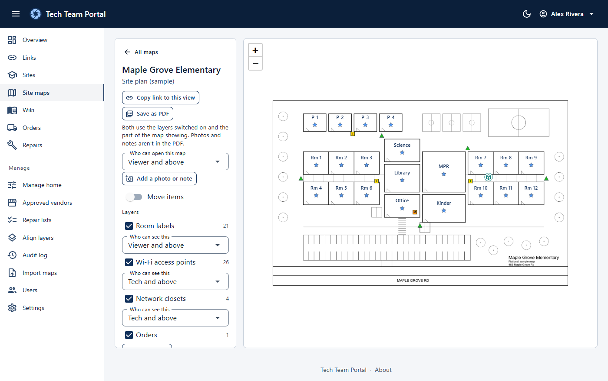

# Tech Team Portal

> A self-hosted toolkit for school IT teams.



## At a glance

- **One place:** links, site information, site maps, orders, repairs and a team wiki.
- **Simple:** one container and one database file, with no email server or cloud account to set up.
- **Private:** no telemetry and no outside services. It runs on your network, without internet access.
- **Role-based:** Viewer, Tech, Manager and Admin roles, enforced on the server, with an audit log of every change.

## Features

| | |
|---|---|
| **Overview** | The work waiting on your team, based on each person's role |
| **Links** | A shared, searchable directory with pinned links |
| **Sites** | Addresses, phone numbers, notes, buildings and staff lists |
| **Site maps** | Layers, photos, notes, shareable links and PDF export |
| **Orders** | Each order tracked from request to received, with approved vendors |
| **Repairs** | Check devices in by asset tag, and track repairs, fines and retired devices |
| **Wiki** | A document-style editor with drafts and version history |
| **Accounts** | Local accounts with two-factor sign-in and passkeys |

Camera scanning of asset tags is experimental, so check each tag after scanning.



## Try it

With [Docker](https://docs.docker.com/get-docker/) installed:

```bash
docker run -d --name tech-team-portal --restart unless-stopped -p 127.0.0.1:8080:8080 \
  -v tech-team-portal-data:/app/data ghcr.io/hasibziai/tech-team-portal:latest
```

Open http://localhost:8080 and create the first Admin account. To look around with made-up data, turn on **Manage → Settings → Show test version**.

This only accepts connections from the same computer, because it has no HTTPS on its own. If you're running it on a server without a browser, connect from your PC with an SSH tunnel, then open the same address there:

```bash
ssh -L 8080:localhost:8080 username@server-address
```

To delete the trial and its data:

```bash
docker rm -f tech-team-portal && docker volume rm tech-team-portal-data
```

## Run it for your team

On a Linux server with Docker, and a DNS name pointing at it:

```bash
git clone https://github.com/HasibZiai/tech-team-portal.git
cd tech-team-portal/deploy
cp .env.example .env    # set PCSERV_HOSTNAME and TZ
docker compose up -d
```

Then browse to your hostname and create the first Admin account straight away. This adds [Caddy](https://caddyserver.com/) in front of the app for HTTPS. By default browsers warn about its certificate until it's trusted, so see the [admin guide](docs/admin-guide.md) for your options, along with backups and updates.

## Configuration

All of these are optional. Set them in `deploy/.env`, then run `docker compose up -d` again.

| Setting | What it does | Default |
|---|---|---|
| `TZ` | Time zone for dates, such as `America/New_York` | `UTC` |
| `PCSERV_INVENTORY_NAME` | What to call the system that tracks assets and checkouts | the asset system |
| `PCSERV_INVENTORY_URL` | Adds an Open button for that system on the Repairs page | No button |
| `PCSERV_DEVICE_CONSOLE_NAME` | What to call the console devices are managed from | the device console |
| `PCSERV_DEVICE_CONSOLE_URL` | Adds an Open button for that console on the Repairs page | No button |
| `PCSERV_ASSET_TAG_DIGITS` | Makes the camera scanner ignore other barcodes, such as serial numbers | Any barcode |

Add the device models you own under **Manage → Repair lists** before checking in repairs.

## Security and privacy

- **Finish setup first.** Whoever opens a new install first creates the Admin account.
- **Keep port 8080 off the network.** The app trusts the proxy in front of it, so use the setup above to host it for others.
- **Protect your backups.** The data volume holds your records and sign-in keys.
- **Keep sensitive data out.** Repair records don't need student information, and real maps and network details don't belong in git.

The [known limitations](docs/known-limitations.md) list what the app doesn't do and what hasn't been tested yet. Please report security problems privately through this repository's **Security** tab.

## Documentation

- [Admin guide](docs/admin-guide.md): deploying, HTTPS, importing maps, backups and updates
- [Implementation notes](docs/implementation-notes.md): how it's built
- [Known limitations](docs/known-limitations.md): current limits and untested areas

## Develop

Requires the [.NET 10 SDK](https://dotnet.microsoft.com/download).

```bash
dotnet run --project src/PcServ.Web    # http://localhost:5153
dotnet test
```

## License

[MIT](LICENSE), by Hasib. Third-party components keep their own open-source licenses.
